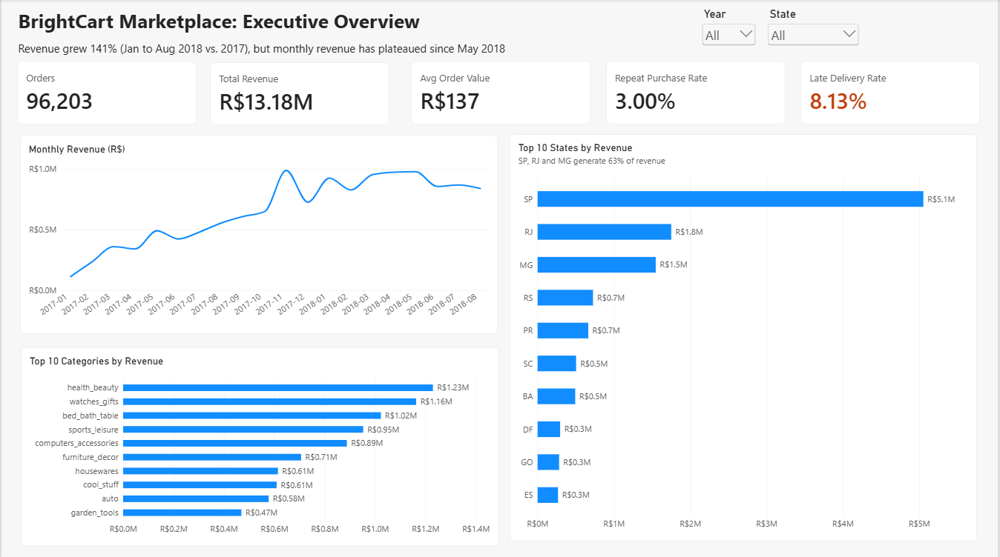
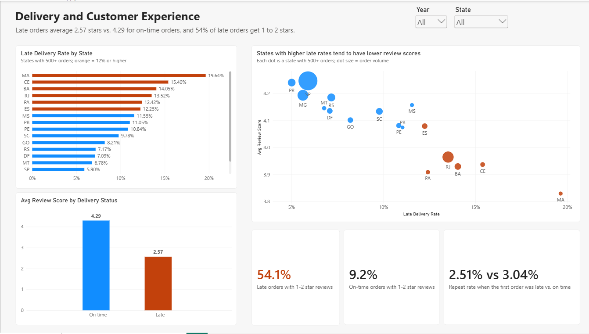

# BrightCart Marketplace: Diagnosing Uneven Growth Across Regions, Customers, and Delivery Performance

An end-to-end business analytics project: SQL analysis of about 100,000 e-commerce orders, a Power BI dashboard, and recommendations for a fictional marketplace's leadership team.

> **Note:** BrightCart Marketplace is a fictional company created for this project. All data comes from the public [Olist Brazilian E-Commerce dataset](https://www.kaggle.com/datasets/olistbr/brazilian-ecommerce) on Kaggle. Amounts are in Brazilian reais (R$). Dataset license: CC BY-NC-SA 4.0, as listed on the Kaggle dataset page. It is used here for non-commercial, educational portfolio purposes, with attribution to Olist.

## Business Problem

BrightCart's leadership noticed that growth is uneven: some regions are expanding while others stall, many customers appear to buy only once, and delivery problems may be hurting customer satisfaction. They need a data-backed view of where growth is strongest and weakest, how well customers are retained, and whether delivery performance is linked to satisfaction.

## Dashboard





## Key Questions

1. Which states had the highest and lowest repeat purchase rate?
2. How do delivery time and late-delivery rate differ between fast-growing and slow-growing states?
3. Which states and product categories drove revenue growth?
4. Which states combine high order volume with weak delivery or low review scores?

## Key Findings

| # | Finding | Evidence |
|---|---|---|
| 1 | **Growth was driven by new customers, and it has plateaued** | Jan to Aug revenue rose 141% year over year (R$2.99M to R$7.22M). New customers rose 138% over the same period but stopped growing in early 2018; monthly revenue peaked at R$978K in May 2018 and was R$839K by August |
| 2 | **Revenue is concentrated** | SP, RJ, and MG generate 63.3% of revenue; the top 10 categories generate 62.4% |
| 3 | **Very few customers return, in every state** | 3.00% repeat purchase rate (2,801 of 93,358 customers); state rates range from 1.67% to 3.28% among states with 500+ customers |
| 4 | **Late deliveries are strongly associated with bad reviews** | 54.0% of late orders received 1 or 2 stars vs. 9.2% of on-time orders; average score 2.57 vs. 4.29 |
| 5 | **Delivery performance varies sharply by region** | Late rate: MA 19.7%, CE 15.3%, BA 14.0%, RJ 13.5% vs. SP 5.9%, PR 5.0%. Average delivery: 8.8 days in SP vs. 21 to 24 days in MA, CE, PA |
| 6 | **A late first delivery is associated with fewer repeat customers** | Repeat rate 2.51% when the first order was late vs. 3.04% when on time (association only) |
| 7 | **Growth by state is uneven, and the delivery link is mixed** | SP grew 170% and MG 153%, while RJ grew 105% and PA 59%. But ES had a 12.2% late rate and still grew 162% |

*Note: the Power BI dashboard covers Jan 2017 to Aug 2018, so some figures differ from the SQL results (which include late 2016) by about 0.1 points. For example, the dashboard shows 54.1% of late orders with 1 to 2 star reviews vs. 54.0% in SQL.*

## Recommendations

1. **Track new customers per month as a leading indicator** and investigate what changed after May 2018.
2. **Prioritize delivery fixes where volume and lateness overlap:** Rio de Janeiro (12,350 orders, 13.5% late), Bahia, and Ceará. Start with carrier and seller reviews.
3. **Pilot a retention program** (for example, a post-purchase offer) in high-volume categories, and measure whether the repeat rate moves from the 3% baseline.
4. **Reduce concentration risk** by protecting service quality in SP, RJ, and MG while testing growth in mid-sized states.
5. **Manage categories differently:** high-ticket categories (watches and gifts average about R$212 per order) need service quality, while high-frequency categories (bed, bath, and table at about R$110 per order) are better candidates for repeat-purchase tactics.

## Methodology

1. **Defined the project:** problem statement, objectives, stakeholders, questions, and KPIs (`01_project_charter.md`).
2. **Loaded and profiled** 9 relational tables into SQLite; identified keys and data-quality issues.
3. **Cleaned and modeled in SQL** using reusable views; every decision is documented in `data_cleaning_log.md`.
4. **Analyzed in SQL** to answer each business question (`02_analysis.sql`).
5. **Built a Power BI dashboard** with a Calendar table, a one-to-many data model, and DAX measures.
6. **Validated** dashboard figures against SQL results before drawing conclusions.

## Data Model

```
customers (customer_id PK, customer_unique_id, state)
    └── orders (order_id PK, customer_id FK, status, purchase/delivery dates)
            ├── order_items (order_id + order_item_id PK, product_id FK, seller_id FK, price, freight)
            ├── order_reviews (order_id FK, review_score)
            └── order_payments (order_id FK)
products (product_id PK) ── category_translation
sellers (seller_id PK)
```

Key data trap: `customer_id` is generated per order. Customer metrics use `customer_unique_id`.

## SQL Example

Repeat purchase rate: customers with 2 or more delivered orders, using a CTE and conditional aggregation.

```sql
WITH orders_per_person AS (
  SELECT c.customer_unique_id, COUNT(o.order_id) AS order_count
  FROM olist_customers_dataset AS c
  INNER JOIN olist_orders_dataset AS o ON c.customer_id = o.customer_id
  WHERE o.order_status = 'delivered'
  GROUP BY c.customer_unique_id
)
SELECT
  COUNT(*) AS total_customers,
  SUM(CASE WHEN order_count >= 2 THEN 1 ELSE 0 END) AS repeat_customers,
  ROUND(100.0 * SUM(CASE WHEN order_count >= 2 THEN 1 ELSE 0 END) / COUNT(*), 2) AS repeat_rate_pct
FROM orders_per_person;
-- Result: 93,358 customers, 2,801 repeat, 3.00%
```

Month-over-month revenue change with a window function:

```sql
SELECT month, revenue,
       ROUND(100.0 * (revenue - LAG(revenue) OVER (ORDER BY month))
             / LAG(revenue) OVER (ORDER BY month), 1) AS mom_change_pct
FROM monthly;
```

See `02_analysis.sql` for all queries.

## Power BI Model and Measures

- **Model:** `Calendar` (1) → `orders_fact` (many) → joined one-to-many to `items_category`, loaded from two SQL views exported as CSVs.
- **Pages:** (1) Executive Overview: KPI cards, monthly revenue trend, top states and categories. (2) Delivery and Customer Experience: late rate by state, review score by delivery status, late rate vs. review score scatter, and three supporting stats.

```dax
Late Delivery Rate = AVERAGE(orders_fact[is_late])

Repeat Customers =
CALCULATE(DISTINCTCOUNT(orders_fact[customer_unique_id]), orders_fact[Customer Orders] >= 2)

Repeat Purchase Rate = DIVIDE([Repeat Customers], [Unique Customers])

Low Review % Late =
CALCULATE(DIVIDE([Low Review Orders], [Rated Orders]), orders_fact[Delivery Status] = "Late")
```

I validated the dashboard cards (orders, revenue, late rate, repeat rate) against the SQL results before publishing.

## How to Reproduce

1. Download the dataset from Kaggle (Olist Brazilian E-Commerce Public Dataset) into `data/raw/`. The raw files are not stored in this repo.
2. Import the 9 CSVs into SQLite (for example with DB Browser for SQLite), keeping the original table names, with "column names in first line" checked.
3. Run `02_analysis.sql` (Step 0 creates the views, then run each query).
4. Open `dashboard/brightcart.pbix` in Power BI Desktop. The processed CSVs it was built from (`v_orders_fact.csv`, `v_items_category.csv`) are in `data/processed/`; you may need to re-point the data source paths.

## Limitations

- No cost or profit data, so performance is measured with revenue, delivery, reviews, and retention, not margin.
- Findings show association, not causation (for example, late deliveries and low reviews move together, but the data cannot prove lateness is the cause).
- About two years of data, so the 3% repeat rate is likely a floor.
- Results for smaller states rest on small counts.

## Repository Structure

```
├── README.md
├── 01_project_charter.md
├── 02_analysis.sql
├── data_cleaning_log.md
├── data/
│   ├── raw/            (original CSVs, not edited)
│   └── processed/      (exported SQL views for Power BI)
├── dashboard/          (brightcart.pbix, brightcart_dashboard.pdf)
└── images/             (dashboard screenshots)
```

## Skills Demonstrated

- **SQL:** joins, CTEs, subqueries, CASE, aggregates, date functions, window functions (LAG, ROW_NUMBER), views
- **Data cleaning and validation:** handling NULLs, duplicate keys, multi-row joins, and definition decisions, documented in a log
- **Power BI:** data modeling, relationships, Calendar table, DAX measures and calculated columns, KPI cards, slicers, multi-visual layout
- **Business analysis:** problem framing, KPI definition, stakeholder mapping, insight-to-recommendation reasoning
- **Communication:** findings written for a non-technical audience, with limitations stated

## Author

**Carter Kapanjie**, Business Information Systems (Analytics), Illinois State University

- Portfolio: [carterkapanjie.wordpress.com](https://carterkapanjie.wordpress.com/)
- LinkedIn: [linkedin.com/in/carter-kapanjie](https://www.linkedin.com/in/carter-kapanjie/)
- Email: [carter.j.kapanjie@gmail.com](mailto:carter.j.kapanjie@gmail.com)
